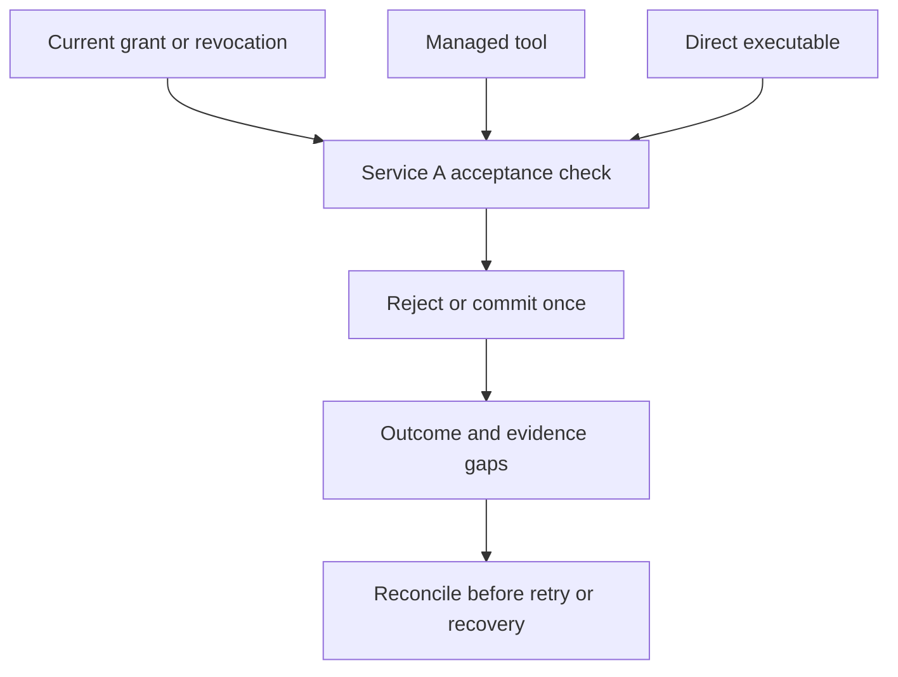

# Worked example: withdrawing a queued payment
**Illustrative design walkthrough, not an implemented system or executed experiment.** Amounts, actors and outcomes below are synthetic.

## The task and threat model
A finance owner authorizes an invoice agent to prepare a draft and submit one payment of at most $100 to receiving service A. The agent's credential is intended for A, not service B. The owner may withdraw approval before acceptance. The agent may make mistakes or receive misleading context; a compromised receiver or issuer is outside the baseline and must be treated as a separate dependency failure.

The receiver is the service that can accept or commit the payment. The controller schedules the agent's work. They are different enforcement and evidence sources.

## Where the decision belongs

Both execution routes must reach effective authorization checks. The diagram does not imply that every route is already captured or every receiver trustworthy.

## One timeline, several distinct claims

| Step | Synthetic event | Required behavior or evidence |
|---|---|---|
| 1 | Owner grants this task, receiver and amount limit. | Bind task, sponsor, actual principal, intended audience, operation, amount, expiry and grant version. A valid token alone does not establish all these conditions. |
| 2 | Controller queues the payment under grant version 7. | A queued record is intent, not receiver acceptance or a reservation of future authority. |
| 3 | Owner revokes version 7 before receiver acceptance. | Service A must use effective current authority at its acceptance boundary. State the propagation delay and what may remain usable during it. |
| 4 | Managed tool submits the old request. | Reject under effective revocation. Record the receiver result, not merely the controller's “stopped” status. |
| 5 | Agent tries a direct program using the same credential. | The alternate route must not bypass the receiving policy. OS isolation separately limits which credentials the process can reach. |
| 6 | Agent continues drafting an unrelated report. | Permit that safe task if its authority remains valid; withdrawal need not halt all useful work. |
| 7 | A fresh, valid grant permits a new payment. | Permit legitimate completion within the new bounds. Renewal is not restoration of the old grant. |

Revocation and acceptance need an explicit ordering rule. If the payment committed before revocation took effect, the correct account is “committed before effective restriction,” not “revocation undid the payment.” A request still in flight may have an unknown outcome until receiver evidence arrives.

## Lost receipt variant
Suppose Service A committed the authorized payment, but the controller lost its response. The controller must not infer failure and blindly issue another payment. Use an operation identifier and a receiver-supported idempotency or status lookup mechanism. These mechanisms have their own scope, retention and availability limits.

If the receiver cannot establish the outcome, keep it unknown and apply a consequence-appropriate hold or escalation. An observer reporting no matching event is insufficient when capture was incomplete. A later receipt can improve reconstruction without having prevented the original effect.

## What the minimum record might contain
Task and operation identifiers; sponsor; actual principal; non-secret credential reference; receiver and operation; bounded effect; grant/policy version; relevant acceptance time or ordering evidence; receiver decision; committed-effect status; source and observation interval; known gaps; withdrawal/recovery owner.

Do not copy bearer tokens, live access links, payment credentials or raw sensitive payloads into this record. A receipt's authenticity is limited by its source and failure domain.

## Local control versus added reconciliation
**Local baseline:** Service A enforces current task scope, audience, limits and idempotency. OS permissions restrict credential access. If these checks mediate every consequential route and return reliable outcomes, an additional runtime verifier may add little.

**Possible reconciliation benefit:** compare controller intent with receiver acceptance across queues or services, detect a surviving capability, or prevent a retry when the outcome is unknown. That benefit is conditional on timely, sufficiently independent evidence and an effective intervention path.

**Failure limit:** a separate collector cannot recover an event never emitted or reverse an already disclosed secret. Stronger local enforcement must not be mistaken for a benefit of observing more events.

Use the [checklist](CHECKLIST.md) to review this example and the [comparison specification](VALIDATION.md) to understand how the incremental benefit could be tested. No result is asserted here.
